<div align="center">

# 🏥 MediFlow Healthcare System

### A secure, role-based telemedicine platform for appointment booking, online consultation, payments, and digital prescriptions


**Student:** `<Md. Rakibul Islam>` &nbsp;|&nbsp; **ID:** `<IT-24029>` &nbsp;|&nbsp; 
**Course Title:** `<Software Engineering and Project Management>` &nbsp;|&nbsp;
**Course Code:** `<ICT-3107>` &nbsp;|&nbsp;
</div>


## 📑 Table of Contents

1. [Executive Summary](#1-executive-summary)
2. [Problem Statement](#2-problem-statement)
3. [Proposed Solution and Workflow](#3-proposed-solution-and-workflow)
4. [Objectives](#4-objectives)
5. [Scope and Limitations](#5-scope-and-limitations)
6. [Users, Roles and Permissions](#6-users-roles-and-permissions)
7. [Functional Requirements](#7-functional-requirements)
8. [Non-Functional Requirements](#8-non-functional-requirements)
9. [Technology Stack and Justification](#9-technology-stack-and-justification)
10. [Software Process Model](#10-software-process-model)
11. [System Architecture](#11-system-architecture)
12. [UML and Data Diagrams](#12-uml-and-data-diagrams)
13. [Key Technical Design Decisions](#13-key-technical-design-decisions)
14. [Database Design](#14-database-design)
15. [User Interface Plan](#15-user-interface-plan)
16. [API Design Proposal](#16-api-design-proposal)
17. [Project Schedule and Gantt Chart](#17-project-schedule-and-gantt-chart)
18. [Milestones and Deliverables](#18-milestones-and-deliverables)
19. [Testing Strategy](#19-testing-strategy)
20. [Security and Privacy](#20-security-and-privacy)
21. [Setup and Configuration](#22-setup-and-configuration)
22. [Environment Variables](#23-environment-variables)
23. [Proposed Repository Structure](#24-proposed-repository-structure)
24. [Learning Outcomes](#25-learning-outcomes)
25. [Future Improvements](#26-future-improvements)
26. [Conclusion](#27-conclusion)
27. [References and Project Links](#28-references-and-project-links)

---

## 1. Executive Summary

**MediFlow** is a web-based telemedicine platform that connects patients with **verified doctors** for remote consultations. It covers the complete journey in one system:

> 🔐 Sign in → 🩺 Find a doctor's open slot → 💳 Pay → 🎫 Get a booking and serial number → 🎥 Join the consultation → 📄 Receive a digital prescription

Doctors apply and are reviewed by administrators, publish schedules that the system splits into **20-minute slots**, and issue prescriptions after consultations. Administrators and Super Administrators manage applications and accounts under strict **role-based authorization**.

### At a Glance

| | |
|---|---|
| **Domain** | Digital healthcare / telemedicine |
| **Application type** | Responsive web application |
| **Frontend** | Next.js, React, Tailwind CSS |
| **Backend** | Java 21+, Spring Boot 3, Spring Security, REST API |
| **Database** | PostgreSQL 16+ with Spring Data JPA / Hibernate |
| **Authentication** | JWT; proposed Google sign-in for patients |
| **Build tool** | Maven |
| **Users** | Patients, Doctors, Admins, Super Admins |
| **Main outcomes** | Booking, consultation workflow, invoices, prescriptions |
| **Ownership** | Individual project |

### 🌟 Project Highlights

| Highlight | Why it matters |
|---|---|
| **Automatic slot generation** | A 3–8 hour schedule becomes 9–24 bookable 20-minute slots with no manual effort |
| **Double-booking prevention** | Enforced by transactions *and* a database-level uniqueness rule, not just application code |
| **Payment-safe booking flow** | Booking is created only after verified payment; failures are handled by reconciliation/refund |
| **Backend-enforced authorization** | Four roles with ownership checks; hiding a button is never treated as security |
| **Doctor verification workflow** | Only approved doctors can publish schedules |
| **Clear cancellation policy** | Refund eligibility is a deterministic, testable rule (more than 1 hour before start) |
| **Design-first approach** | DFD, use case, activity, ERD, class, object, and state diagrams before coding |
| **Test-driven quality gates** | Concurrency, authorization, and migration checks are defined up front |

---

## 2. Problem Statement

Traditional appointment workflows often require patients to call clinics, repeatedly confirm doctor availability, and keep paper-based appointment and prescription records. Doctors and administrators struggle to coordinate schedules, identify open slots, and maintain consistent booking records.

| Stakeholder | Current pain point |
|---|---|
| **Patient** | Repeated calls, uncertain availability, lost paper prescriptions |
| **Doctor** | Manual schedule coordination, no central record of bookings |
| **Administrator** | No structured way to verify doctors or manage accounts |
| **Clinic** | Inconsistent records, no-shows, unclear payment/refund handling |

**MediFlow** proposes a single centralized application that makes the workflow clearer, more accessible, and easier to maintain.

---

## 3. Proposed Solution and Workflow

```mermaid
flowchart LR
    A[1. Patient registers / signs in] --> B[2. Doctor applies]
    B --> C[3. Admin approves or rejects]
    C --> D[4. Doctor publishes schedule]
    D --> E[5. System generates 20-min slots]
    E --> F[6. Patient selects open slot]
    F --> G[7. Payment confirmed]
    G --> H[8. Booking + serial number + receipt]
    H --> I[9. Consultation]
    I --> J[10. Digital prescription]
```

### Proposed Business Rules

| # | Rule |
|---|---|
| BR-1 | A doctor schedule covers **3–8 hours** on one day. |
| BR-2 | Published schedules are divided into **20-minute** slots. |
| BR-3 | Patients see eligible open slots for **the current day, before the slot's start time**. |
| BR-4 | A slot must **never** be booked by more than one active appointment. |
| BR-5 | Cancellation **more than one hour before** the schedule start qualifies for a refund; later cancellation does not. |
| BR-6 | Prescriptions are associated with **completed** appointments. |
| BR-7 | Administrative actions are restricted by **role and authorization rules**. |

### Worked Example (Slot Generation)

A doctor publishes a schedule from **15:00 to 18:00** (3 hours, valid):

| Slot | Time | Slot | Time |
|---|---|---|---|
| 1 | 15:00 – 15:20 | 6 | 16:40 – 17:00 |
| 2 | 15:20 – 15:40 | 7 | 17:00 – 17:20 |
| 3 | 15:40 – 16:00 | 8 | 17:20 – 17:40 |
| 4 | 16:00 – 16:20 | 9 | 17:40 – 18:00 |
| 5 | 16:20 – 16:40 | | |

Result: **9 slots**. An 8-hour schedule yields **24 slots**.

> ⚠️ **Important:** Payment-gateway integration, video-call provider integration, refund processing, and email/PDF delivery require provider credentials and implementation. They are **design requirements**, not claims that these services are already operational. A documented **test-payment adapter** will be used where a live provider is not configured.

---

## 4. Objectives

### General Objective

To design and develop a secure, maintainable web-based system for managing online medical consultations and their related appointment, payment, and prescription workflows.

### Specific Objectives

| # | Objective |
|---|---|
| O1 | Provide registration, authentication, and role-based access |
| O2 | Support patient and doctor profile management |
| O3 | Provide a review workflow for doctor applications |
| O4 | Allow approved doctors to create and publish schedules |
| O5 | Generate consultation slots automatically |
| O6 | Prevent conflicting bookings for the same slot |
| O7 | Support appointment booking and payment-status tracking |
| O8 | Apply a clearly defined cancellation and refund policy |
| O9 | Support consultation status updates and digital prescriptions |
| O10 | Generate or deliver appointment receipts and prescription documents |
| O11 | Provide a responsive interface for desktop, tablet, and mobile |
| O12 | Apply testing, documentation, version control, and deployment practices |

---

## 5. Scope and Limitations

| ✅ In Scope | ❌ Out of Scope (Initial Version) |
|---|---|
| Patient registration and login | Emergency medical services or triage |
| Proposed Google OAuth2 sign-in for patients | Automated diagnosis or AI treatment recommendations |
| OTP email verification and password recovery | Native Android / iOS application |
| Role-based access (Patient, Doctor, Admin, Super Admin) | Integration with hospital EHR systems |
| Doctor application submission and approval | Insurance claim processing |
| Doctor profile and schedule management | Guaranteed legal/regulatory compliance without separate review |
| Automatic 20-minute slot generation | Recording or storing video calls |
| Booking, serial numbers, payment status | Real-money payments until a provider and test environment are configured |
| Cancellation and refund eligibility rules | |
| Consultation status updates | |
| Digital prescription records | |
| Email notifications and PDF receipts/prescriptions | |
| Administrative account and user management | |
| Responsive frontend and REST API | |

> MediFlow is a software engineering project and is **not** a substitute for professional medical advice or emergency services.

---

## 6. Users, Roles and Permissions

### Role Summary

| Role | Main responsibilities |
|---|---|
| 🧑‍⚕️ **Patient** | Manage profile, view eligible slots, book and cancel appointments, view own prescriptions and invoices |
| 👨‍⚕️ **Doctor** | Apply for approval, manage profile, publish schedules, conduct consultations, write prescriptions |
| 🛡️ **Admin** | Review doctor applications, block/unblock eligible accounts, create Admin accounts if authorized |
| 👑 **Super Admin** | Perform administrative actions and manage Admin and Super Admin accounts |

### Permission Matrix (Proposed)

| Capability | Patient | Doctor | Admin | Super Admin |
|---|:---:|:---:|:---:|:---:|
| Register / sign in | ✅ | ✅ | ✅ | ✅ |
| Manage own profile | ✅ | ✅ | ✅ | ✅ |
| Apply as doctor | – | ✅ | – | – |
| Review doctor applications | – | – | ✅ | ✅ |
| Create / publish schedules | – | ✅ (approved) | – | – |
| Browse and book slots | ✅ | – | – | – |
| Cancel own appointment | ✅ | – | – | – |
| Update consultation status | – | ✅ (assigned) | – | – |
| Create prescription | – | ✅ (assigned) | – | – |
| View own prescription / invoice | ✅ | ✅ (own consultations) | – | – |
| Block / unblock eligible accounts | – | – | ✅ | ✅ |
| Create Admin accounts | – | – | Subject to policy | ✅ |
| Create Super Admin accounts | – | – | – | ✅ |

### Permission Principles

- Patients can access **only their own** personal information, bookings, invoices, and prescriptions.
- Doctors manage **their own** schedules and access consultations **assigned to them**.
- Admins perform only the administrative actions allowed by policy.
- Super Admin privileges are limited to authorized system-management operations.
- **The backend must enforce authorization.** Hiding a button in the frontend is not sufficient security.

---

## 7. Functional Requirements

| ID | Requirement | Priority | Related Objective |
|---|---|:---:|:---:|
| FR-01 | The system shall allow patients to register and sign in. | High | O1 |
| FR-02 | The system shall verify direct registrations using an email OTP. | High | O1 |
| FR-03 | The system shall support password recovery and password changes. | High | O1 |
| FR-04 | The system shall support doctor applications and administrative review. | High | O3 |
| FR-05 | The system shall allow approved doctors to manage profiles. | High | O2 |
| FR-06 | The system shall allow doctors to create and publish schedules. | High | O4 |
| FR-07 | The system shall generate 20-minute slots from valid schedules. | High | O5 |
| FR-08 | The system shall display eligible available slots to patients. | High | O5 |
| FR-09 | The system shall prevent double booking of a slot. | High | O6 |
| FR-10 | The system shall record payment status for appointments. | High | O7 |
| FR-11 | The system shall create a booking and serial number after confirmed payment. | High | O7 |
| FR-12 | The system shall apply the proposed cancellation/refund rules. | High | O8 |
| FR-13 | The system shall support consultation status changes. | High | O9 |
| FR-14 | The system shall store prescriptions linked to appointments. | High | O9 |
| FR-15 | The system shall restrict data and actions according to user roles. | High | O1 |
| FR-16 | The system should email relevant booking and prescription documents. | Medium | O10 |
| FR-17 | The system should provide administrative user-management screens. | Medium | O3 |
| FR-18 | The interface should be responsive and accessible. | Medium | O11 |

---

## 8. Non-Functional Requirements

| Category | Requirement |
|---|---|
| 🔒 **Security** | Password hashing, authenticated endpoints, authorization checks, input validation, secure secret management, safe error responses |
| 🕵️ **Privacy** | A patient must never be able to retrieve another patient's private records |
| ⚙️ **Reliability** | Booking operations handle concurrent requests safely |
| 🧩 **Maintainability** | Layered backend, clear naming, modular components, documented APIs |
| 🙂 **Usability** | Clear navigation, validation messages, loading/empty states, confirmation before destructive actions |
| 🚀 **Performance** | Paginate or filter larger lists; avoid unnecessary database queries |
| 🌐 **Compatibility** | Current major desktop and mobile browsers |
| 🧪 **Testability** | Business logic testable independently from controllers and external providers |
| ☁️ **Availability** | Depends on the hosting and database providers selected |
| ♿ **Accessibility** | Semantic HTML, keyboard-friendly controls, readable contrast, labelled form fields |

---

## 9. Technology Stack and Justification

| Layer | Technology | Purpose | Why this choice |
|---|---|---|---|
| Frontend framework | **Next.js** | Pages, routing, frontend app | File-based routing, strong React ecosystem |
| UI library | **React** | Reusable interactive components | Component model suits role-based dashboards |
| Styling | **Tailwind CSS** | Responsive styling and design system | Fast, consistent responsive design |
| Backend language | **Java 21+** | Application and business logic | Strong typing, mature enterprise ecosystem |
| Backend framework | **Spring Boot 3** | REST API, dependency management | Production-grade conventions and tooling |
| Security | **Spring Security** | Authentication and endpoint authorization | Industry-standard, method-level role checks |
| Token auth | **JWT** | Stateless access-token authentication | Scales without server-side sessions |
| Database | **PostgreSQL 16+** | Persistent relational data | ACID transactions, partial unique indexes |
| ORM | **Spring Data JPA / Hibernate** | Entity persistence and queries | Reduces boilerplate, integrates with Spring |
| Migrations | **Flyway or Liquibase** | Versioned schema changes | Reproducible databases from a clean state |
| Build tool | **Maven** | Build, dependencies, tests | Standard for Spring Boot projects |
| Email | **Spring Mail / SMTP** | OTPs and notifications | Native Spring integration |
| PDF | **OpenPDF or iText** *(license review)* | Receipts and prescriptions | Programmatic document generation |
| API testing | **Postman or equivalent** | Manual API verification | Shareable collections |
| Version control | **Git and GitHub** | Source control and review | Traceable history |

### Technology Decisions

- **No Prisma.** Database access is implemented in the Spring Boot backend with Spring Data JPA/Hibernate.
- **PostgreSQL** stores users, profiles, schedules, slots, appointments, payments, invoices, and prescriptions.
- **Frontend/backend separation.** Next.js calls the Spring Boot REST API; the frontend never connects directly to PostgreSQL.
- **External services** (Google OAuth2, SMTP, payment, video meeting links, PDF) are configured and tested separately behind adapters.

---

## 10. Software Process Model

The project follows an **iterative and incremental** model. It fits because the system has several modules that can be designed, built, tested, and reviewed in stages, and requirements can be refined after supervisor feedback.

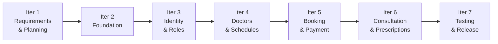

| Iteration | Focus |
|---|---|
| 1 | Define use cases, scope, milestones, and diagrams |
| 2 | Set up repositories, Spring Boot, Next.js, PostgreSQL, configuration, basic UI |
| 3 | Authentication, profiles, authorization |
| 4 | Doctor applications, approval, schedules, slots |
| 5 | Booking constraints, appointment status, payment integration or documented test-payment adapter |
| 6 | Consultation status, prescription records, document delivery |
| 7 | Tests, defect fixes, documentation, deployment |

At the end of each iteration, the feature set is reviewed against its **acceptance criteria**. Requirement changes are documented rather than silently added to scope.

---

## 11. System Architecture

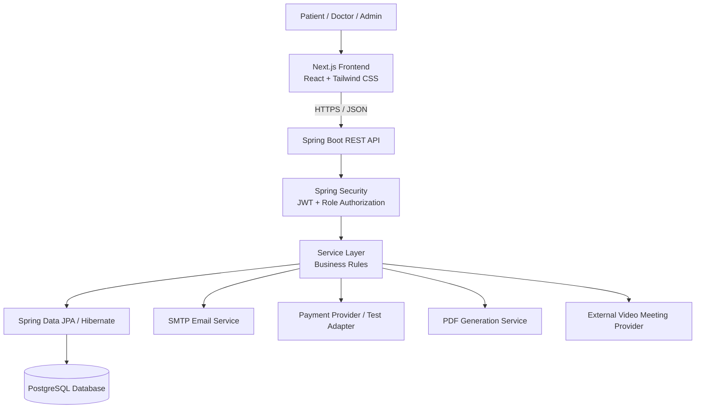

### Layer Responsibilities

| Layer | Responsibility |
|---|---|
| **Presentation** | Pages, forms, tables, dashboards, client-side interaction (Next.js) |
| **API / Controller** | Receives HTTP requests, validates request shapes, returns appropriate responses |
| **Service** | Enforces business rules: schedule validation, slot eligibility, booking, cancellation, permissions |
| **Persistence** | Repositories and JPA entities store and retrieve data |
| **Database** | Relational integrity and unique constraints |
| **Integration** | Encapsulates email, payment, PDF, and meeting-link provider operations behind interfaces |

---

## 12. UML and Data Diagrams

The diagrams use Mermaid syntax, which GitHub renders natively. If a viewer does not render them, paste them into the Mermaid Live Editor and export as images for the final report.

### 12.1 Data Flow Diagram (DFD — Level 1)

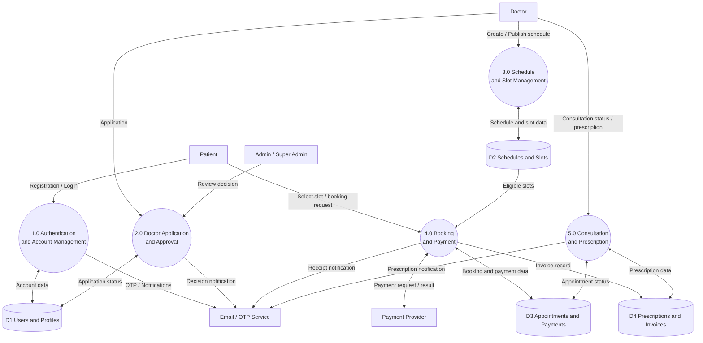

### 12.2 Use Case Diagram

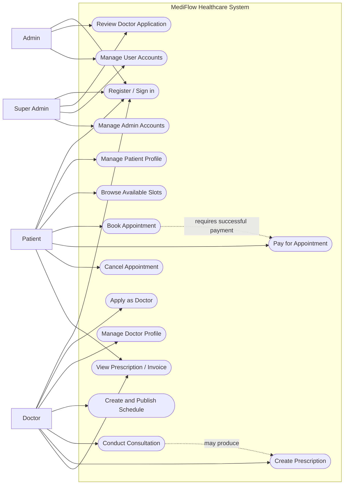

### 12.3 Activity Diagram — Appointment Booking

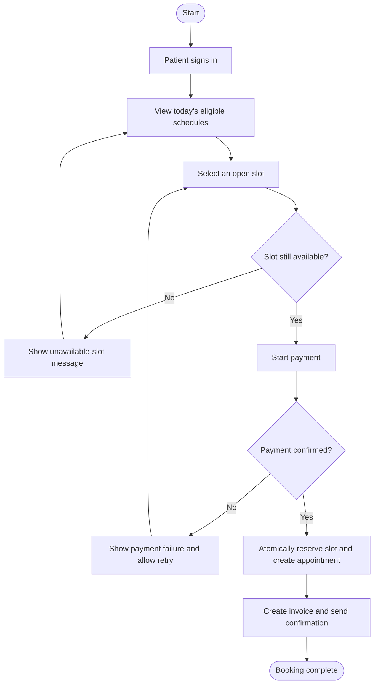

**Implementation note:** The backend re-checks slot availability inside the booking transaction. The database enforces a uniqueness rule preventing multiple active appointments for one slot. The payment workflow also accounts for *payment success followed by booking failure* through provider verification and a safe reconciliation/refund process.

### 12.4 Entity Relationship Diagram (ERD)

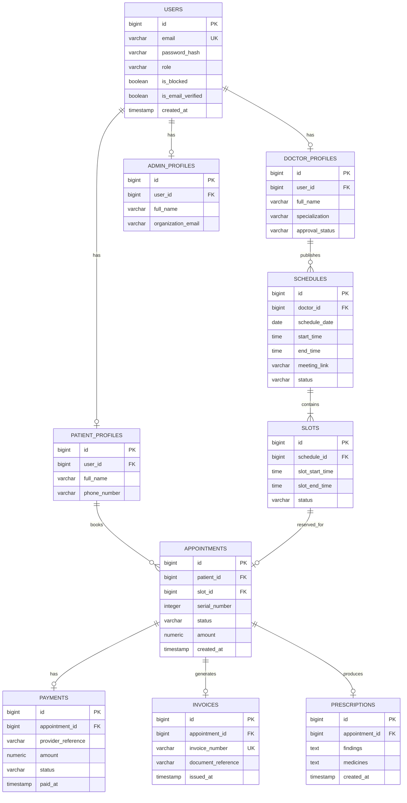

**ERD notes:** This is a proposed logical model. Exact columns, nullability, indexes, and delete/update behavior will be finalized during database design. Payment provider references should be unique when supplied. Appointment-to-slot uniqueness and transaction behavior must prevent double booking. Unnecessary medical information will not be stored.

### 12.5 Class Diagram

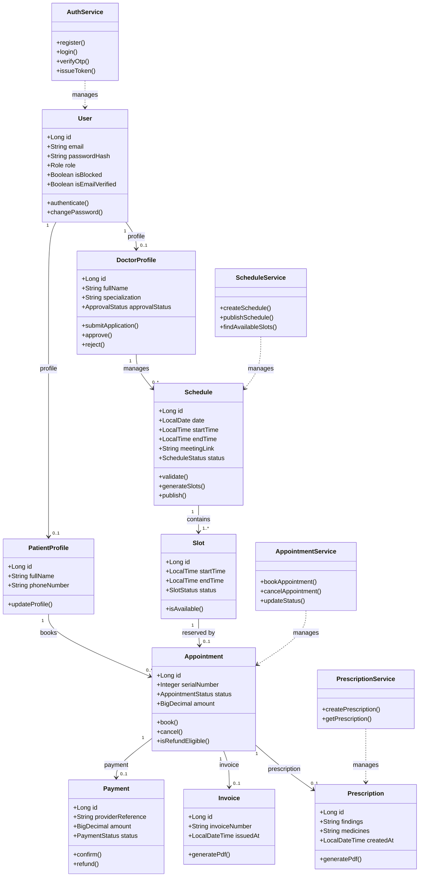

The class diagram identifies **more than five** domain and service classes that guide the initial interface and implementation. Final Java classes and relationships may be refined during development.

### 12.6 Object Diagram

An illustrative snapshot using **fictional sample data** (no real patient information).

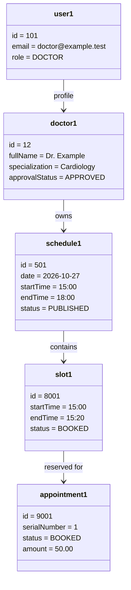

### 12.7 State Diagram — Appointment Lifecycle

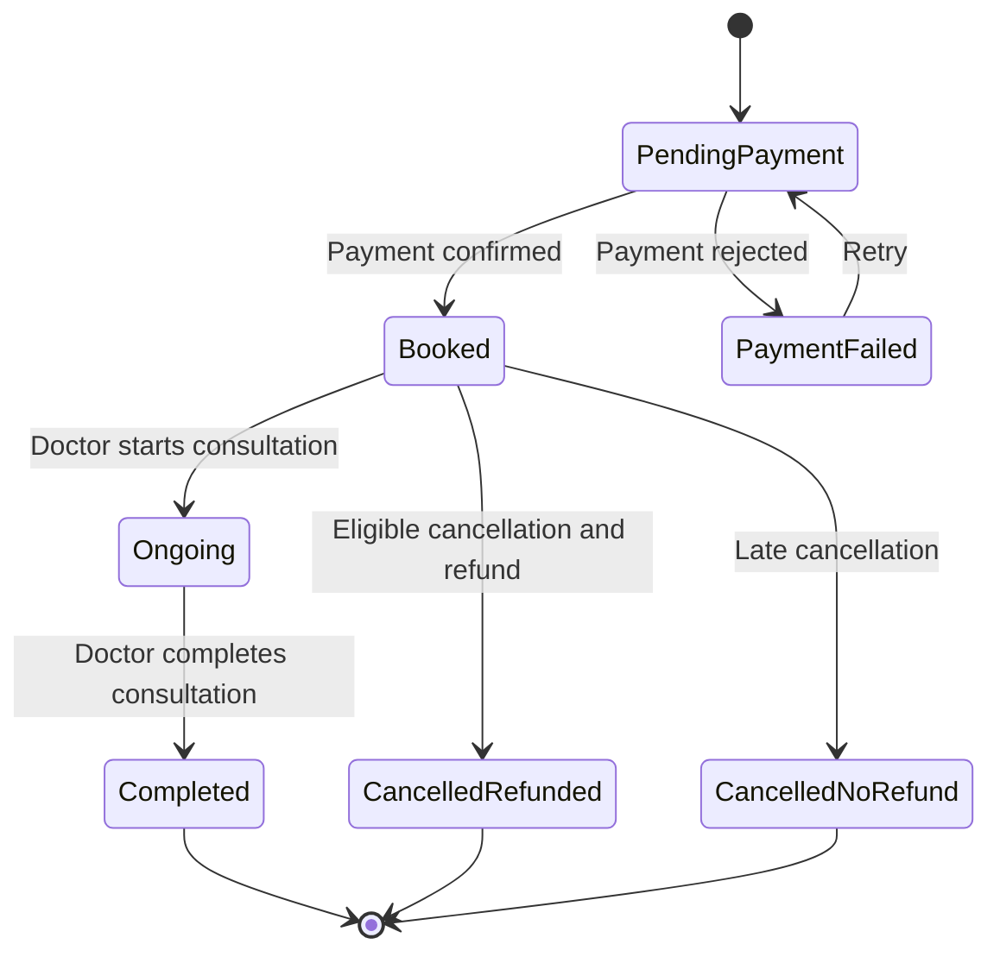

### 12.8 Sequence Diagram — Booking with Payment Verification

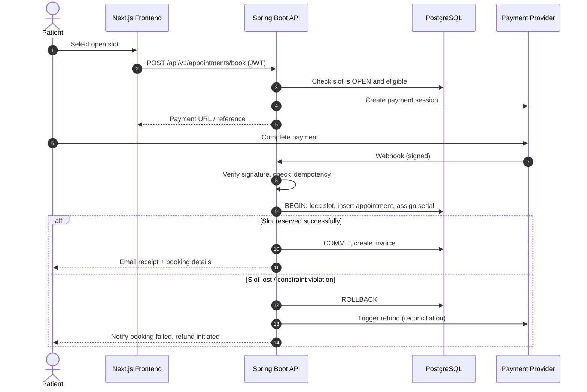

---

## 13. Key Technical Design Decisions

This section explains the hardest engineering problems in the project and how they will be addressed.

### 13.1 Preventing Double Booking (Concurrency)

Two patients may click the same slot at the same moment. Application-level checks alone are not enough, so protection is layered:

1. **Transaction + row lock** — lock the slot row (`SELECT ... FOR UPDATE`) inside the booking transaction.
2. **Database constraint (last line of defense)** — a partial unique index so only one *active* appointment can exist per slot:

```sql
CREATE UNIQUE INDEX uq_active_appointment_per_slot
    ON appointments (slot_id)
    WHERE status IN ('PENDING_PAYMENT', 'BOOKED', 'ONGOING', 'COMPLETED');
```

3. **Concurrency test** — a automated test fires many simultaneous booking requests at one slot and asserts that exactly **one** succeeds.

### 13.2 Slot Generation

```text
validate(schedule):
    duration = endTime - startTime
    require 3h <= duration <= 8h
    require duration is a multiple of 20 minutes
    require schedule date/time not in the past

generateSlots(schedule):
    cursor = startTime
    while cursor + 20min <= endTime:
        create Slot(cursor, cursor + 20min, status = OPEN)
        cursor += 20min
```

A valid schedule produces between **9 and 24 slots**. Boundary cases (exactly 3h, exactly 8h, non-multiple of 20 min) are covered by unit tests.

### 13.3 Cancellation and Refund Rule

```text
isRefundEligible(appointment, now):
    return now < schedule.startDateTime - 1 hour
```

| Cancel time (schedule starts 15:00) | Outcome |
|---|---|
| Before 14:00 | `CANCELLED_REFUNDED` — refund initiated |
| 14:00 or later | `CANCELLED_NO_REFUND` — slot released, no refund |

The rule is a pure function with an injectable clock, so it can be unit-tested at the exact boundary.

### 13.4 Safe Payment Handling

| Concern | Design |
|---|---|
| Client could fake "paid" | The server never trusts a client-supplied payment result; only a **signature-verified webhook** or provider API verification confirms payment |
| Duplicate webhook events | Processing is **idempotent**, keyed on a unique `provider_reference` |
| Paid but booking failed | Reconciliation job detects the mismatch and triggers a refund |
| Price tampering | Amount is read server-side from the doctor/schedule configuration |
| Provider unavailable in development | A **test-payment adapter** implements the same `PaymentGateway` interface |

### 13.5 Provider Adapters (Replaceable Integrations)

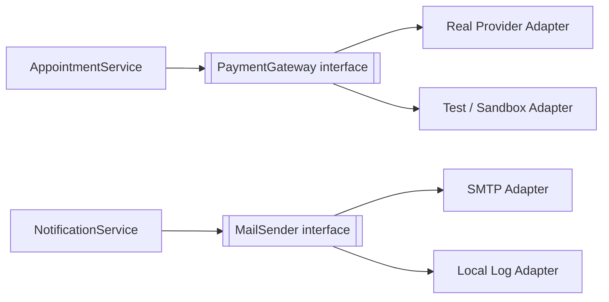

Interfaces keep the business logic independent of external providers, which makes the code testable and reduces the risk of delays in provider configuration.

### 13.6 Authorization Strategy

- **Role check** with Spring Security (`@PreAuthorize("hasRole('DOCTOR')")`).
- **Ownership check** in the service layer (for example, a patient may read an appointment only if `appointment.patientId == currentUser.profileId`).
- Unauthorized resource access returns a safe `403`/`404` without revealing whether the record exists.

---

## 14. Database Design

PostgreSQL is the primary database. Spring Data JPA/Hibernate maps Java entities to tables, and Flyway or Liquibase manages versioned migrations.

### Main Tables

| Table | Purpose |
|---|---|
| `users` | Login identity, email, password hash, role, verification and account status |
| `patient_profiles` | Patient-specific profile fields |
| `doctor_profiles` | Doctor details and application approval state |
| `admin_profiles` | Administrator profile information |
| `schedules` | Doctor schedules and meeting-link metadata |
| `slots` | Generated consultation slots and booking state |
| `appointments` | Patient booking, serial number, status, and amount |
| `payments` | Provider reference, amount, payment/refund status |
| `invoices` | Invoice number and document metadata |
| `prescriptions` | Findings and prescribed medicines linked to an appointment |

### Data Integrity Rules

- User email must be **unique**.
- Each profile must reference a valid user.
- Each schedule must reference an **approved** doctor.
- Each slot must reference a valid schedule.
- A slot may have **at most one active appointment**.
- Appointment and payment statuses use defined enumerated values.
- Prescription creation must be authorized and tied to the correct consultation.
- Migrations are committed to version control and must run from a clean database.

---

## 15. User Interface Plan

The Next.js frontend uses reusable components styled with Tailwind CSS. Interfaces are responsive and role-aware.

### Planned Pages

| Page | Main interface elements |
|---|---|
| Public landing page | Navigation, hero section, service overview, doctor discovery entry point, footer |
| Register / Login | Validated forms, password visibility, OTP verification, helpful errors |
| Patient dashboard | Upcoming appointments, status, quick actions |
| Browse schedules | Date and doctor information, available slots, search/filter |
| Booking and payment | Selected slot summary, amount, payment status, confirmation |
| Appointment details | Booking reference, serial number, meeting link, cancellation eligibility |
| Patient prescriptions | Authorized prescription list and document access |
| Doctor dashboard | Today's appointments, schedule summary, consultation actions |
| Doctor application | Profile details, specialization, application status |
| Schedule management | Create/edit schedule, slot preview, publish action |
| Consultation workspace | Appointment information, status updates, prescription form |
| Admin dashboard | Pending applications, account status, management actions |
| Super Admin dashboard | Admin account management and elevated controls |
| Shared UI | Loading skeletons, empty states, validation messages, confirmation dialogs, 404 page |

### Wireframe Sketch — Browse Schedules (Patient)

```text
┌────────────────────────────────────────────────────────────┐
│  MediFlow            Dashboard   Schedules   Prescriptions │
├────────────────────────────────────────────────────────────┤
│  Available Today                  [ Search specialization ]│
│                                                            │
│  ┌──────────────────────────────────────────────────────┐  │
│  │ Dr. Example — Cardiology            15:00 – 18:00    │  │
│  │ [15:00] [15:20] [15:40] [16:00] [16:20] ...          │  │
│  │  open    open   booked   open    open                │  │
│  └──────────────────────────────────────────────────────┘  │
│                                                            │
│  Selected: 15:20 – 15:40      Fee: 50.00    [ Pay & Book ] │
└────────────────────────────────────────────────────────────┘
```

### Classes Represented in the UI (at least five)

| # | Class | UI representation |
|---|---|---|
| 1 | `User` | Sign-in state, role, account information |
| 2 | `DoctorProfile` | Doctor name, specialization, approval status |
| 3 | `Schedule` | Schedule date, start/end time, publication state |
| 4 | `Slot` | Individual available consultation time buttons |
| 5 | `Appointment` | Booking details, serial number, status |
| 6 | `Payment` | Payment status and reference |
| 7 | `Prescription` | Findings and medicines |
| 8 | `Invoice` | Invoice number and receipt details |

The frontend uses **typed API response models** rather than manipulating database entities directly.

---

## 16. API Design Proposal

Versioned REST endpoints are exposed under `/api/v1`. These routes are **proposed contracts** and must be implemented and tested before they are considered available.

### 16.1 Authentication — `/api/v1/auth`

| Method | Endpoint | Access | Purpose |
|---|---|---|---|
| POST | `/register/patient` | Public | Register a patient and initiate verification |
| POST | `/verify-otp` | Public | Verify email OTP |
| POST | `/login` | Public | Authenticate with email and password |
| POST | `/login/google` | Public | Exchange/verify Google sign-in credentials |
| POST | `/forgot-password` | Public | Initiate password recovery |
| POST | `/reset-password` | Public | Complete password reset |
| POST | `/change-password` | Authenticated | Change current password |
| POST | `/set-password` | Eligible patient | Set password for a Google-registered patient |

### 16.2 Doctor Applications — `/api/v1/doctors`

| Method | Endpoint | Access | Purpose |
|---|---|---|---|
| POST | `/apply` | Public | Submit a doctor application |
| GET | `/applications` | Admin / Super Admin | List applications |
| PATCH | `/{id}/approve` | Admin / Super Admin | Approve application |
| PATCH | `/{id}/reject` | Admin / Super Admin | Reject application |
| GET | `/me` | Doctor | View own doctor profile |
| PATCH | `/me` | Doctor | Update permitted profile fields |

### 16.3 Schedules — `/api/v1/schedules`

| Method | Endpoint | Access | Purpose |
|---|---|---|---|
| POST | `/` | Approved Doctor | Create a draft schedule |
| PATCH | `/{id}/publish` | Schedule owner | Publish a valid schedule |
| PUT | `/{id}` | Schedule owner | Update a schedule when permitted |
| GET | `/today` | Patient | List eligible schedules for today |
| GET | `/{id}/slots` | Authorized user | List schedule slots |

### 16.4 Appointments — `/api/v1/appointments`

| Method | Endpoint | Access | Purpose |
|---|---|---|---|
| POST | `/book` | Patient | Request a booking and begin payment flow |
| GET | `/me` | Patient / Doctor | List the caller's authorized appointments |
| GET | `/{id}` | Authorized participant | Retrieve appointment details |
| POST | `/{id}/cancel` | Booking patient | Request cancellation |
| PATCH | `/{id}/status` | Assigned Doctor | Update consultation status |

### 16.5 Payments, Invoices, and Prescriptions

| Method | Endpoint | Access | Purpose |
|---|---|---|---|
| POST | `/api/v1/payments/webhook` | Verified provider | Receive payment-provider events |
| GET | `/api/v1/appointments/{id}/invoice` | Authorized participant | Retrieve invoice metadata/document |
| POST | `/api/v1/prescriptions` | Assigned Doctor | Create a prescription for an eligible appointment |
| GET | `/api/v1/prescriptions/{id}` | Authorized participant | Retrieve prescription details/document |

### 16.6 Administration — `/api/v1/admin`

| Method | Endpoint | Access | Purpose |
|---|---|---|---|
| POST | `/create-admin` | Admin / Super Admin, subject to policy | Create an Admin account |
| POST | `/create-super-admin` | Super Admin | Create a Super Admin account |
| PATCH | `/users/{id}/block` | Authorized Admin / Super Admin | Block an eligible account |
| PATCH | `/users/{id}/unblock` | Authorized Admin / Super Admin | Unblock an eligible account |

### 16.7 Example Contract (Illustrative)

**Request:** `POST /api/v1/appointments/book`

```json
{
  "slotId": 8001
}
```

**Response `201 Created`** *(returned after payment session creation)*

```json
{
  "appointmentId": 9001,
  "status": "PENDING_PAYMENT",
  "amount": 50.00,
  "paymentReference": "pay_test_8f3a21",
  "expiresInSeconds": 600
}
```

**Error response (consistent structure)**

```json
{
  "timestamp": "2026-10-27T15:52:10+06:00",
  "status": 409,
  "error": "SLOT_UNAVAILABLE",
  "message": "This slot has already been booked. Please choose another.",
  "path": "/api/v1/appointments/book"
}
```

### API Design Rules

- Validate request bodies and query parameters.
- Return consistent HTTP status codes and error structures.
- Require authorization on all private routes.
- Never trust a client-supplied role, payment result, price, or user ID without server-side validation.
- Verify payment webhooks using the provider's signature mechanism.
- Use transactions and database constraints to prevent duplicate bookings.
- Document request/response examples (OpenAPI/Swagger) as implementation progresses.

---

## 17. Project Schedule and Gantt Chart

This is a **proposed 12-week plan**; dates will be adjusted to the course deadline and supervisor feedback.

### 12-Week Schedule

| Week | Activities | Expected result |
|:---:|---|---|
| 1 | Confirm scope, problem statement, objectives, requirements | Approved initial proposal |
| 2 | Requirements analysis, use cases, DFD, architecture | Requirements and DFD |
| 3 | ERD, class/object/activity diagrams, UI wireframes | Design package |
| 4 | Repository setup, Next.js, Tailwind, Spring Boot, PostgreSQL | Running project skeleton |
| 5 | User model, authentication, profile pages, security baseline | Authentication foundation |
| 6 | Doctor application and approval workflow | Doctor-management module |
| 7 | Schedule management and slot generation | Schedule module |
| 8 | Booking, concurrency handling, payment status | Booking module |
| 9 | Cancellation policy, consultation status, invoice flow | Appointment lifecycle |
| 10 | Prescription workflow, email/PDF integration | Prescription module |
| 11 | Integration tests, security checks, bug fixes, responsive UI | Release candidate |
| 12 | Deployment, README, final report, demonstration, submission | Final deliverables |

### Gantt Chart

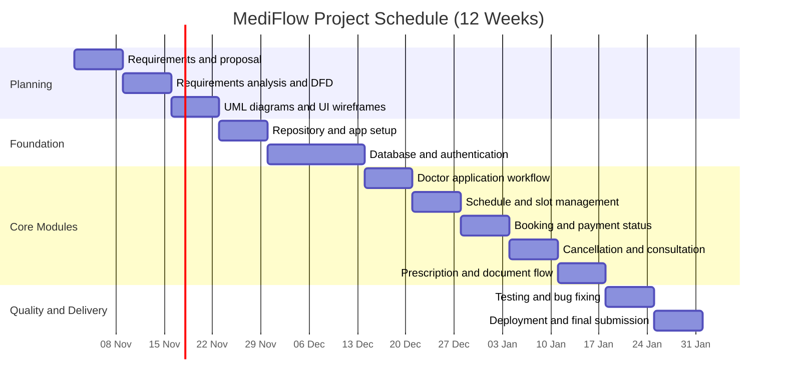

> **Schedule note:** The chart uses an illustrative start date of **2 November 2026**. Dates and durations will be adjusted to the actual course calendar. The timeline is a planning estimate, not a guarantee.

---

## 18. Milestones and Deliverables

| Milestone | Target | Deliverables / acceptance criteria |
|---|:---:|---|
| **M1** — Proposal approved | Week 1 | Problem statement, objectives, scope, process model, initial schedule |
| **M2** — Requirements and design complete | Week 3 | Requirements, DFD, use case, activity, ERD, class, object diagrams |
| **M3** — Technical foundation ready | Week 4 | GitHub repository, Next.js frontend, Spring Boot API, PostgreSQL connection |
| **M4** — Identity and roles ready | Week 5 | Authentication flow, role model, protected routes, basic profile UI |
| **M5** — Doctor and schedule modules ready | Week 7 | Application review, schedule creation, generated slots |
| **M6** — Booking workflow ready | Week 9 | Booking rules, payment status, cancellation/refund eligibility |
| **M7** — Consultation and prescription ready | Week 10 | Consultation lifecycle and prescription records |
| **M8** — Final release | Week 12 | Tested application, README, screenshots, deployment details, final report, demo |

### Final Submission Checklist

- [ ] Project proposal with problem statement and objectives
- [ ] Software process model and rationale
- [ ] Project schedule, milestones, deliverables, and Gantt chart
- [ ] DFD, use case, activity, ERD, class, and object diagrams
- [ ] Database design and implementation plan
- [ ] UI demonstrating at least five classes from the class diagram
- [ ] Source code in a GitHub repository
- [ ] README with setup instructions and technology stack
- [ ] Test plan and test results
- [ ] Screenshots or a demonstration of implemented features
- [ ] Live deployment URL, if required by the course
- [ ] Proposal/report formatted using the professor's recommended LaTeX template, if required

---

## 19. Testing Strategy

| Level | What is verified |
|---|---|
| **Unit** | Schedule validation, 20-minute slot generation, cancellation eligibility, role checks, status transitions |
| **Integration** | Spring Boot endpoints with a test database, repository operations, authentication, transaction behavior |
| **API** | Valid/invalid requests, response codes, authorization, validation errors, webhook verification |
| **Frontend** | Navigation, form validation, loading/error/empty states, role-based screens, responsive layouts |
| **Concurrency** | Many simultaneous requests for one slot result in exactly one booking |
| **Security** | Attempts to access another user's records are denied |

### Sample Test Cases

| ID | Scenario | Expected result |
|---|---|---|
| TC-01 | Create schedule of 2 hours | Rejected (below 3-hour minimum) |
| TC-02 | Create schedule 15:00–18:00 | 9 slots generated |
| TC-03 | Create schedule of 9 hours | Rejected (above 8-hour maximum) |
| TC-04 | Two patients book the same slot simultaneously | Exactly one succeeds; the other gets `409` |
| TC-05 | Cancel 61 minutes before start | Refund eligible |
| TC-06 | Cancel 59 minutes before start | No refund |
| TC-07 | Replay the same payment webhook twice | Processed once (idempotent) |
| TC-08 | Patient A requests Patient B's prescription | Access denied |
| TC-09 | Unapproved doctor tries to publish a schedule | Rejected |
| TC-10 | Blocked user attempts login | Rejected |

### End-to-End Scenarios

1. A patient registers and verifies an email address.
2. A doctor applies and an administrator approves the application.
3. The approved doctor publishes a schedule.
4. A patient books an available slot and receives a confirmed booking after payment confirmation.
5. The patient cancels and the system applies the stated refund eligibility rule.
6. The doctor completes a consultation and creates a prescription.
7. A user attempts to access another user's private record and is denied.

### Quality Gates

- ✅ No known critical authorization bypass
- ✅ No duplicate active booking for one slot
- ✅ Database migrations run from a clean database
- ✅ Core workflow tests pass
- ✅ Setup instructions are reproducible
- ✅ Secrets are not committed to the repository

### Requirements Traceability (Summary)

| Requirement | Design artifact | Test coverage |
|---|---|---|
| FR-01–03 (auth) | Use case 12.2, `AuthService`, auth API | E2E #1, TC-10 |
| FR-04 (doctor review) | DFD 2.0, `DoctorProfile` | E2E #2, TC-09 |
| FR-06–08 (schedule/slots) | `Schedule`, `Slot`, Section 13.2 | TC-01–03, E2E #3 |
| FR-09 (no double booking) | Section 13.1, partial unique index | TC-04 |
| FR-10–11 (payment/booking) | Sequence diagram 12.8, Section 13.4 | TC-07, E2E #4 |
| FR-12 (cancellation) | State diagram 12.7, Section 13.3 | TC-05, TC-06, E2E #5 |
| FR-13–14 (consultation/prescription) | `Prescription`, DFD 5.0 | E2E #6 |
| FR-15 (authorization) | Section 13.6 | TC-08, E2E #7 |

---

## 20. Security and Privacy

| Area | Planned control |
|---|---|
| Passwords | Strong hashing supported by Spring Security (for example BCrypt); never plaintext |
| Secrets | JWT keys, OAuth secrets, SMTP passwords, payment credentials in environment variables or a secret manager |
| Authorization | Role and ownership checks enforced on the backend |
| Transport | HTTPS in deployed environments |
| Input | Validate and normalize input; never return stack traces or sensitive data |
| Tokens | Short-lived access tokens; carefully designed refresh strategy if implemented |
| Webhooks | Verify provider signatures; handle duplicates idempotently |
| Documents | Restrict prescription and invoice access to authorized users |
| Logging | No medical information, access tokens, or passwords in logs |
| Integrity | Database constraints and transactions protect booking integrity |
| Data lifecycle | Define retention, backup, and deletion practices before production use |

> The system may process sensitive health-related information. Before real-world deployment, applicable laws, healthcare requirements, payment-provider terms, and hosting/security obligations must be reviewed with qualified professionals.

---

## 21. Setup and Configuration

These instructions describe the **intended** local development setup and become fully accurate once the repository files and configuration are implemented.

### Prerequisites

- Git
- Node.js LTS and npm (or the selected package manager)
- Java 21 or the project-selected compatible JDK
- Maven 3.9+
- PostgreSQL 16+
- A code editor or IDE
- Optional provider accounts: SMTP, Google OAuth2, payment processing, video meeting integration

### Quick Start

```bash
# 1. Clone (replace with the real URL)
git clone https://github.com/<your-username>/mediflow-healthcare-system.git
cd mediflow-healthcare-system
```

```sql
-- 2. Create the database
CREATE DATABASE mediflow_db;
```

```bash
# 3. Run the backend (after setting environment variables)
cd backend
mvn clean test
mvn spring-boot:run          # http://localhost:8080
```

```bash
# 4. Run the frontend
cd frontend
npm install
npm run dev                  # http://localhost:3000
```

Do not use production credentials locally, and never commit secrets. If frontend and backend are separate repositories, follow the README in each.

### Production Build

```bash
# Backend
mvn clean package

# Frontend
npm run build
npm run start
```

Exact commands may change with the final repository structure and package scripts.

---

## 22. Environment Variables

| Variable | Purpose | Example / default |
|---|---|---|
| `SPRING_DATASOURCE_URL` | PostgreSQL JDBC URL | `jdbc:postgresql://localhost:5432/mediflow_db` |
| `SPRING_DATASOURCE_USERNAME` | Database username | `mediflow_app` |
| `SPRING_DATASOURCE_PASSWORD` | Database password | Set locally; do not commit |
| `JWT_SECRET` | JWT signing secret | Use a securely generated secret |
| `JWT_EXPIRATION_MS` | Access token lifetime | `900000` (15 minutes, proposed) |
| `JWT_REFRESH_EXPIRATION_MS` | Refresh token lifetime, if used | `604800000` (7 days, proposed) |
| `SPRING_MAIL_HOST` | SMTP host | `smtp.gmail.com` for a compatible Gmail setup |
| `SPRING_MAIL_PORT` | SMTP port | `587` for STARTTLS setups |
| `SPRING_MAIL_USERNAME` | Sender account | Set locally |
| `SPRING_MAIL_PASSWORD` | SMTP credential / app password | Set locally; do not commit |
| `GOOGLE_CLIENT_ID` | Google OAuth2 client ID | From Google Cloud configuration |
| `GOOGLE_CLIENT_SECRET` | Google OAuth2 client secret | Set locally; do not commit |
| `PAYMENT_PROVIDER_SECRET` | Payment provider secret | Set locally if payment integration is enabled |
| `PAYMENT_WEBHOOK_SECRET` | Webhook signature verification secret | Set locally if applicable |
| `NEXT_PUBLIC_API_BASE_URL` | Frontend API base URL | `http://localhost:8080/api/v1` |

> Example values are for local development only. A public (`NEXT_PUBLIC_*`) variable must **never** contain a private secret.

---

## 23. Proposed Repository Structure

```text
mediflow-healthcare-system/
├── frontend/
│   ├── app/
│   │   ├── (public)/
│   │   ├── patient/
│   │   ├── doctor/
│   │   ├── admin/
│   │   └── super-admin/
│   ├── components/
│   ├── lib/
│   ├── types/
│   ├── public/
│   ├── package.json
│   └── README.md
├── backend/
│   ├── src/
│   │   ├── main/
│   │   │   ├── java/
│   │   │   │   └── .../
│   │   │   │       ├── config/
│   │   │   │       ├── security/
│   │   │   │       ├── auth/
│   │   │   │       ├── user/
│   │   │   │       ├── doctor/
│   │   │   │       ├── schedule/
│   │   │   │       ├── appointment/
│   │   │   │       ├── payment/
│   │   │   │       ├── prescription/
│   │   │   │       └── common/
│   │   │   └── resources/
│   │   │       ├── db/migration/
│   │   │       └── application.yml
│   │   ├── test/
│   │   └── pom.xml
│   └── README.md
├── docs/
│   ├── proposal/
│   ├── diagrams/
│   ├── screenshots/
│   └── test-plan.md
├── .gitignore
└── README.md
```

This structure is a proposal and can be adjusted to match the actual repository.

---

## 24. Learning Outcomes

This project is designed to demonstrate the following software engineering competencies:

| Competency | Where it is demonstrated |
|---|---|
| Requirements engineering | Sections 2, 4, 7, 8, traceability table |
| Software process selection | Section 10 (iterative and incremental) |
| Object-oriented analysis and design | Class and object diagrams, service layer |
| Structured and behavioral modeling | DFD, use case, activity, state, sequence diagrams |
| Relational database design | ERD, constraints, migrations, partial unique index |
| Secure API development | JWT, RBAC, ownership checks, webhook verification |
| Concurrency and transaction handling | Section 13.1, TC-04 |
| Testing and quality assurance | Section 19 test levels, quality gates |
| Project management | Gantt chart, milestones, risk register |
| Documentation and version control | README, GitHub, versioned migrations |

---

## 25. Future Improvements

- 🔍 Doctor search by specialization and availability
- ⭐ Ratings and verified patient feedback
- 📅 Calendar synchronization and appointment reminders
- 🌍 Additional language support (for example, Bangla)
- 📊 Analytics dashboards for administrators
- 🔗 Secure integration with external medical record systems, subject to permission and compliance requirements
- ♿ Accessibility audits and usability testing
- 📈 Monitoring, backups, and operational dashboards
- 💳 Additional payment providers where appropriate
- 🚢 Deployment automation and continuous integration

---

## 26. Conclusion

MediFlow Healthcare System proposes a modular, secure approach to online medical consultation management. By combining a responsive **Next.js** frontend, a **Spring Boot** REST API, and **PostgreSQL**, the project will demonstrate requirements analysis, software design, database modeling, object-oriented design, secure API development, testing, and project planning.

The initial deliverable is this proposal and implementation plan. During development, each feature will be implemented incrementally, tested against its requirements, and documented. The final submission will include working source code, diagrams, test evidence, and the repository link.

---


- [Next.js](https://nextjs.org/docs)
- [Tailwind CSS](https://tailwindcss.com/docs)
- [Spring Boot](https://docs.spring.io/spring-boot/index.html)
- [Spring Security](https://docs.spring.io/spring-security/reference/)
- [PostgreSQL](https://www.postgresql.org/docs/)
- [Mermaid](https://mermaid.js.org/)

---

<div align="center">

**MediFlow Healthcare System** — *Initial Software Project Proposal*
Prepared by `Md Rakibul Islam` 

</div>
